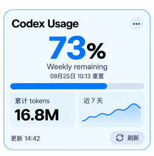

# Codex Usage Widget — Windows 11 原生小组件

把 Codex 订阅额度显示到 Windows 11 自带小组件面板（任务栏天气 / `Win + W`）的原生小组件。

基于 **C# / Windows App SDK (WinUI 3)** 开发，原生集成系统小组件看板，**完全独立运行，无需安装 Python**。



---

## ✨ 功能特性

- **额度展示**：直观显示当前剩余额度百分比与重置时间倒计时。
- **Full reset 提示**：有可用的 usage limit reset 时显示可用次数；无可用次数或旧版 Codex 未返回该字段时自动隐藏。
- **到期提醒**：已知 Full reset 到期时间时，预约一条到期前 24 小时的 Windows 通知；额度变化或小组件移除时更新预约。
- **双窗口明细**：同时展示 Primary / Secondary（通常对应 5 小时 / Weekly 窗口）明细。
- **动态趋势曲线**：股票小组件风格的平滑 SVG 曲线图（平滑样条 + 渐变填充 + 端点圆点）：
  - 剩余 ≥60% 绿色、≤15% 红色，其余状态跟随主题蓝色。
  - 自动保留 30 天采样历史（保存在 `%USERPROFILE%\.codex_usage_widget_history.json`）。
- **主题与尺寸自适应**：
  - 自动跟随系统深色 / 浅色模式切换。
  - 支持 **小 (Small) / 中 (Medium) / 大 (Large)** 三种尺寸；小尺寸精简关键百分比，大尺寸展示完整曲线与套餐类型。
- **低功耗运行**：面板可见时每 60 秒刷新一次，面板收起或不可见时自动休眠。

---

## 🚀 快速安装（推荐）

直接前往 [**Releases**](https://github.com/hxshenaaa/codex_widgets/releases) 下载适合你电脑架构的安装包：

- **`CodexUsageWidget-x64.zip`**：绝大多数 Intel / AMD 电脑（64位）
- **`CodexUsageWidget-arm64.zip`**：高通骁龙 Copilot+ PC / Surface Pro X 等 ARM64 设备
- **`CodexUsageWidget-x86.zip`**：32 位系统兼容包

### 安装步骤

1. 下载并解压相应的 `.zip` 压缩包。
2. 鼠标右键解压出来的 **`Install.ps1`** → 选择 **“使用 PowerShell 运行”**。
   - *(脚本会自动以管理员权限导入自签名证书、配置依赖并安装 MSIX 包)*
3. 安装完成后，按键盘快捷键 **`Win + W`** 打开 Windows 小组件面板。
4. 点击面板右上角的 **`+`** 号（添加小组件）→ 在列表底部找到 **`Codex Usage`** → 点击 **“固定”** 即可。

> **前置要求**：
> 1. Windows 11 22H2+（带任务栏小组件看板）。
> 2. 本机已安装 [Codex CLI](https://github.com/openai/codex) 并完成 ChatGPT 账号登录（在终端运行 `codex` 能正常响应）。若 codex 安装在非默认路径，可配置环境变量 `CODEX_PATH` 指向该可执行文件。

---

## 🛠️ 从源码构建

如需自行修改代码或本地构建 MSIX 包：

### 前提环境
- Windows 11
- [.NET 8.0 SDK](https://dotnet.microsoft.com/download/dotnet/8.0)+

### 构建命令
```powershell
cd codex_widget_provider

# 构建默认 x64 包
powershell -ExecutionPolicy Bypass -File .\build_msix.ps1

# 或指定架构构建（x64 / arm64 / x86）
powershell -ExecutionPolicy Bypass -File .\build_msix.ps1 -Architecture arm64
```

脚本会自动：
1. 本地生成或导入开发签名证书 `CN=CodexUsageWidgetDev`；
2. 信任公钥证书到本地计算机受信任列表；
3. 执行 `dotnet publish` 生成带签名的 sideload MSIX 包并输出到 `AppPackages\` 目录。

### 卸载小组件
在 PowerShell 执行：
```powershell
Get-AppxPackage CodexUsageWidget | Remove-AppxPackage
```

---

## 🔍 数据链路与原理解析

小组件为纯离线与本地通信机制，无需也不存储任何用户密钥：

1. 后台通过标准输入输出调用：
   ```text
   codex app-server --stdio
   ```
2. 完成 `initialize` 协议握手，并读取额度接口：
   ```text
   account/rateLimits/read
   ```
3. 组件采用官方 **Web Widget** 规范渲染：
   - 桩卡片注册指向保留域 `https://codexwidget.invalid/`；
   - 通过 manifest 的 `WebRequestFilter` 拦截到 C# 中的 `IWidgetResourceProvider.OnResourceRequested`；
   - 在内存中直接返回自绘 HTML/SVG 与局部数据，完全离线响应。

---

## ⚠️ 已知问题 (Known Issues)

- **Windows Widgets "Switch to new look" 下卡片更多操作 (more action) 弹窗被遮盖**：
  - **现象**：在 Windows Widgets 切换到新外观/新布局（Switch to new look / lock）后，当卡片并列排放时，点击卡片右上角“更多选项 / 更多操作”（More actions / `...`）弹出的菜单会被右侧相邻卡片遮盖。
  - **原因**：这是 Windows 11 小组件看板宿主（Windows Web Experience Pack / `Widgets.exe`）在多列网格容器排版下的层叠上下文（`z-index` / Stacking Context）Bug，弹窗未置于全局顶级层或当前卡片未提升层级，属于 Windows 系统小组件宿主端已知渲染缺陷。

