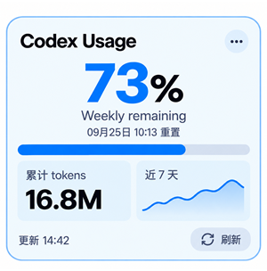

# Codex Usage Widget — Windows 11 / macOS 系统小组件

## macOS 版

`macos/CodexUsage.xcodeproj` 包含宿主 App 与 WidgetKit Extension，支持 macOS 14 及更新版本的桌面和通知中心小组件。小、中、大三种尺寸展示剩余额度和过去 24 小时的本地 token 消耗总量；中、大尺寸还显示逐小时消耗的平滑曲线，大尺寸显示最近本地任务及各任务的 token 用量。宿主 App 通过已登录的 Codex CLI 读取额度，并从本机 `~/.codex/sessions` 汇总 token 使用记录，再写入 App Group；小组件从共享快照展示。Full reset 到期前 24 小时提醒可在 App 内开启。

### 构建与添加

1. 安装并首次启动完整 Xcode，阅读并接受许可协议；另需已登录 ChatGPT 账号的 [Codex CLI](https://github.com/openai/codex)。
2. 用 Xcode 打开 `macos/CodexUsage.xcodeproj`。在 `CodexUsage` 和 `CodexUsageWidget` 两个 target 的 Signing & Capabilities 中选择同一个 Team，并确保两者都启用 App Groups：`group.com.hxshenaaa.codexusagewidget`。若这个 group ID 已被其他团队占用，请同时修改两个 entitlement 文件和 `SharedSnapshotStore.swift` 中的 ID，再用你的 Team 注册。
3. 选择 `CodexUsage` scheme，在本机运行。首次启动后等待额度出现；找不到 CLI 时，在 App 中填写 `codex` 可执行文件的绝对路径并保存。
4. 在桌面或通知中心打开 macOS 的“编辑小组件”，搜索 **Codex Usage**，添加所需尺寸。

命令行构建（配置好签名团队之后）：

```sh
DEVELOPER_DIR=/Applications/Xcode.app/Contents/Developer xcodebuild \
  -project macos/CodexUsage.xcodeproj -scheme CodexUsage \
  -configuration Debug -destination 'platform=macOS' build
```

本版采用 Xcode 本机构建与签名方式，没有预签名的 Mac 安装包。对外分发需要为两个 target 配置正式签名，并完成 macOS 分发与公证流程。App 运行期间会在启动、手动刷新、约每 15 分钟和睡眠唤醒时取数；退出 App 后保留最后一次快照，WidgetKit 的刷新频率由系统决定。通知权限仅在点击“开启 Full reset 提醒”时请求。

字段约定与实现说明见 [Usage snapshot 字段约定](docs/usage-snapshot-contract.md) 和 [macOS 实现记录](docs/macos-widget-plan.md)。

---

## Windows 11 版

把 Codex 订阅额度显示到 Windows 11 自带小组件面板（任务栏天气 / `Win + W`）的原生小组件。

基于 **C# / Windows App SDK (WinUI 3)** 开发，原生集成系统小组件看板，**完全独立运行，无需安装 Python**。



### 切换账号并保留本地项目和会话

1. 从 Windows 开始菜单打开「Codex Usage Accounts」，或点击小组件的「账号」。当前原生登录显示在第一行，点「收录当前账号」后会自动同步更新的原生凭据。
2. 用「添加账号」打开 Codex 官方浏览器登录，或先在原生 Codex 登录另一个账号再收录。浏览器添加的新账号先用「仅切换账号」激活一次，打开原生 Codex 初始化，再正常退出。
3. 选择目标账号并点「切换并保留项目」。如果 Codex 仍在运行，确认后小组件会关闭桌面端和命令行进程，正在进行的任务会停止。切换后，小组件会用桌面端自带的后台核对新身份和会话归属。重新打开 Codex，等项目加载后可点「验证切换结果」。遇到项目冲突可以选「仅切换账号」。
4. 「刷新额度与用量」读取已收录账号的 5 小时和周额度。支持官方账号用量接口时也显示账号总量和近期每日用量。读取失败会显示在对应账号行。

小组件用 Windows 当前用户的 DPAPI 加密保存凭据，并把账号显示信息与额度快照单独存放。切换时把本地项目、会话归属和侧边栏顺序合并到目标账号，保留目标账号已有的项目和会话。遇到归属冲突或无法识别的桌面状态会停止切换。订阅额度和额度趋势按账号读取、保存。全机 24 小时和近 7 天 token 用量按本地日志汇总，包含这台机器上各账号的用量。继承会话只更新项目归属，统计时仍读取同一份日志。会话创建账号不能用来判断后续每轮请求由哪个账号消耗。

此功能适用于使用本地 `auth.json` 登录的 Windows 桌面 Codex。新版桌面端的本地项目归属也会写入原生会话数据库，切换前会保存加密备份。验收会分别显示现存的项目会话，以及切换前已找不到会话记录的旧索引。云端项目仍由原账号管理，弹出的窗口布局需要重新打开。

---

## ✨ 功能特性

- **额度展示**：直观显示当前剩余额度百分比与重置时间倒计时。
- **Full reset 提示**：有可用的 usage limit reset 时显示可用次数；无可用次数或旧版 Codex 未返回该字段时自动隐藏。
- **到期提醒**：已知 Full reset 到期时间时，预约一条到期前 24 小时的 Windows 通知；额度变化或小组件移除时更新预约。
- **双窗口明细**：同时展示 Primary / Secondary（通常对应 5 小时 / Weekly 窗口）明细。
- **动态趋势曲线**：股票小组件风格的平滑 SVG 曲线图（平滑样条 + 渐变填充 + 端点圆点）：
  - 剩余 ≥60% 绿色、≤15% 红色，其余状态跟随主题蓝色。
  - 自动保留 30 天采样历史（保存在 `%USERPROFILE%\.codex_usage_widget_history.json`）。
- **主题与尺寸自适应**：
  - 自动跟随系统深色 / 浅色模式切换。
  - 支持 **小 (Small) / 中 (Medium) / 大 (Large)** 三种尺寸；小尺寸精简关键百分比，大尺寸展示完整曲线与套餐类型。
- **低功耗运行**：面板可见时每 60 秒刷新一次，面板收起或不可见时自动休眠。

---

## 🚀 快速安装（推荐）

直接前往 [**Releases**](https://github.com/hxshenaaa/codex_widgets/releases) 下载适合你电脑架构的安装包：

- **`CodexUsageWidget-x64.zip`**：绝大多数 Intel / AMD 电脑（64位）
- **`CodexUsageWidget-arm64.zip`**：高通骁龙 Copilot+ PC / Surface Pro X 等 ARM64 设备
- **`CodexUsageWidget-x86.zip`**：32 位系统兼容包

### 安装步骤

1. 下载并解压相应的 `.zip` 压缩包。
2. 鼠标右键解压出来的 **`Install.ps1`** → 选择 **“使用 PowerShell 运行”**。
   - *(脚本会自动以管理员权限导入自签名证书、配置依赖并安装 MSIX 包)*
3. 安装完成后，按键盘快捷键 **`Win + W`** 打开 Windows 小组件面板。
4. 点击面板右上角的 **`+`** 号（添加小组件）→ 在列表底部找到 **`Codex Usage`** → 点击 **“固定”** 即可。

> **前置要求**：
> 1. Windows 11 22H2+（带任务栏小组件看板）。
> 2. 本机已安装 [Codex CLI](https://github.com/openai/codex) 并完成 ChatGPT 账号登录（在终端运行 `codex` 能正常响应）。若 codex 安装在非默认路径，可配置环境变量 `CODEX_PATH` 指向该可执行文件。
> 3. 运行 MSIX 需要与安装包架构相同的 [.NET 8 Desktop Runtime](https://dotnet.microsoft.com/download/dotnet/8.0)。

---

## 🛠️ 从源码构建

如需自行修改代码或本地构建 MSIX 包：

### 前提环境
- Windows 11
- [.NET 8.0 SDK](https://dotnet.microsoft.com/download/dotnet/8.0)+

### 构建命令
```powershell
cd codex_widget_provider

# 构建默认 x64 包
powershell -ExecutionPolicy Bypass -File .\build_msix.ps1

# 或指定架构构建（x64 / arm64 / x86）
powershell -ExecutionPolicy Bypass -File .\build_msix.ps1 -Architecture arm64
```

脚本会自动：
1. 本地生成或导入开发签名证书 `CN=CodexUsageWidgetDev`；
2. 信任公钥证书到本地计算机受信任列表；
3. 执行 `dotnet publish` 生成带签名的 sideload MSIX 包并输出到 `AppPackages\` 目录。

### 卸载小组件
在 PowerShell 执行：
```powershell
Get-AppxPackage CodexUsageWidget | Remove-AppxPackage
```

---

## 🔍 数据链路与原理解析

小组件为纯离线与本地通信机制，无需也不存储任何用户密钥：

1. 后台通过标准输入输出调用：
   ```text
   codex app-server --stdio
   ```
2. 完成 `initialize` 协议握手，并读取额度接口：
   ```text
   account/rateLimits/read
   ```
3. 组件采用官方 **Web Widget** 规范渲染：
   - 桩卡片注册指向保留域 `https://codexwidget.invalid/`；
   - 通过 manifest 的 `WebRequestFilter` 拦截到 C# 中的 `IWidgetResourceProvider.OnResourceRequested`；
   - 在内存中直接返回自绘 HTML/SVG 与局部数据，完全离线响应。

---

## ⚠️ 已知问题 (Known Issues)

- **Windows Widgets "Switch to new look" 下卡片更多操作 (more action) 弹窗被遮盖**：
  - **现象**：在 Windows Widgets 切换到新外观/新布局（Switch to new look / lock）后，当卡片并列排放时，点击卡片右上角“更多选项 / 更多操作”（More actions / `...`）弹出的菜单会被右侧相邻卡片遮盖。
  - **原因**：这是 Windows 11 小组件看板宿主（Windows Web Experience Pack / `Widgets.exe`）在多列网格容器排版下的层叠上下文（`z-index` / Stacking Context）Bug，弹窗未置于全局顶级层或当前卡片未提升层级，属于 Windows 系统小组件宿主端已知渲染缺陷。
